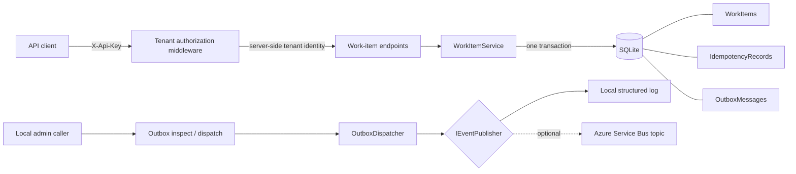

# TenantFlow

TenantFlow is a new, standalone portfolio demonstration of a tenant-scoped work-item API in C# and ASP.NET Core. It is not represented as an employer system, client delivery, production deployment, or Azure resource that has been provisioned.

The sample focuses on boundaries that tend to fail under real load: deriving tenant identity server-side, making retried writes deterministic, rejecting lost updates, and committing business data together with integration intent.

## What it demonstrates

- .NET 10 minimal API and EF Core 10 with durable SQLite storage.
- API-key fixtures mapped to tenants on the server. A caller-supplied tenant header is never used.
- Tenant-qualified queries that return `404` for another tenant's identifiers.
- Atomic create + idempotency receipt + outbox insert in one database transaction.
- Idempotency replay and `409 Conflict` when the same key is reused with different normalized content.
- Strong numeric ETags and `If-Match`; stale updates return `412 Precondition Failed` and create no outbox event.
- Transactional outbox inspection and bounded manual dispatch, with recorded failures and exponential retry timing.
- A local logging publisher by default and a compiled Azure Service Bus topic adapter behind `IEventPublisher`.
- Integration tests against real temporary SQLite files, including 12 concurrent duplicate requests.

## Architecture



`TenantFlow.Core` owns domain persistence and delivery abstractions. `TenantFlow.Api` owns HTTP authentication/authorization and protocol behavior. The test project exercises both through the running ASP.NET Core pipeline.

## Run locally

Prerequisite: the .NET SDK selected by `global.json` (10.0.400 or a later 10.0 patch allowed by its roll-forward policy).

```powershell
dotnet restore TenantFlow.slnx
dotnet build TenantFlow.slnx -c Release --no-restore
dotnet test TenantFlow.slnx -c Release --no-build
dotnet run --project src/TenantFlow.Api --launch-profile http
```

The API listens at `http://localhost:5088` under the checked-in development profile. SQLite creates `tenantflow.db` beside the process working directory; database files are ignored by Git.

Development also enables a deliberately narrow browser CORS policy for the optional Flutter companion at `http://127.0.0.1:5090` or `http://localhost:5090`. It permits only `GET`, `POST`, and `PUT`; the headers `Content-Type`, `X-Api-Key`, `Idempotency-Key`, and `If-Match`; and exposes `ETag`, `Idempotency-Replayed`, and `Location`. There is no wildcard origin, and the policy is not activated outside the ASP.NET Core `Development` environment.

### Create and replay a work item

```powershell
$body = '{"title":"Review tenant boundary","description":"Demonstrate an idempotent write"}'
curl.exe -i http://localhost:5088/api/work-items `
  -H "X-Api-Key: tenant-alpha-key" `
  -H "Idempotency-Key: demo-create-001" `
  -H "Content-Type: application/json" `
  --data $body
```

Repeat the command to receive the stored response with `Idempotency-Replayed: true`. Change the title while keeping the key to receive `409`.

### Read and update with an ETag

Use the created identifier below. The GET response returns `ETag: "1"`.

```powershell
curl.exe -i http://localhost:5088/api/work-items/WORK_ITEM_ID `
  -H "X-Api-Key: tenant-alpha-key"

curl.exe -i -X PUT http://localhost:5088/api/work-items/WORK_ITEM_ID `
  -H "X-Api-Key: tenant-alpha-key" `
  -H 'If-Match: "1"' `
  -H "Content-Type: application/json" `
  --data '{"title":"Boundary reviewed","description":null,"status":"Done"}'
```

Enums use their default JSON numeric form in this compact sample, so `status` may also be sent as `2` (`Open=0`, `InProgress=1`, `Done=2`). Reusing ETag `"1"` after the update returns `412`.

### Inspect and dispatch the local outbox

```powershell
curl.exe http://localhost:5088/internal/outbox?state=pending `
  -H "X-Api-Key: admin-local-key"

curl.exe -X POST "http://localhost:5088/internal/outbox/dispatch?maximum=25" `
  -H "X-Api-Key: admin-local-key"
```

The default local publisher writes event metadata and JSON to the application log, then marks each message processed. Dispatch requests are serialized within this process. Delivery remains at-least-once: a crash after external publish but before the processed flag commits can redeliver, so consumers must deduplicate by outbox `Id`.

## Optional Azure Service Bus adapter

`AzureServiceBusEventPublisher` uses the official `Azure.Messaging.ServiceBus` SDK and sends each outbox ID as `MessageId`, the aggregate ID as `CorrelationId`, the event type as `Subject`, and the tenant ID as an application property. It is disabled by default. No Azure resource, namespace, topic, credentials, or deployment is created by this repository.

To exercise it against resources you control, provide configuration outside source control:

```powershell
$env:Events__Provider = 'AzureServiceBus'
$env:Events__AzureServiceBus__ConnectionString = '<secret-from-your-secure-store>'
$env:Events__AzureServiceBus__Topic = 'tenantflow-events'
dotnet run --project src/TenantFlow.Api --launch-profile http
```

The connection-string path is included only to keep the demo locally runnable. A production design should use `DefaultAzureCredential`, managed identity, Key Vault-backed configuration, and least-privilege RBAC.

## Security and operational boundaries

- The committed keys are obvious development fixtures, not secrets. Production authentication should validate a real identity token, resolve immutable tenant claims, rotate credentials, rate-limit failures, and audit administrative access.
- Tenant isolation is enforced in application queries, not by SQLite row-level security. A production relational deployment should add database defense-in-depth and adversarial authorization tests.
- The in-process keyed coordinator makes concurrent retries atomic in one API instance; the unique `(TenantId, Key)` primary key is the durable guard. SQLite is intentionally a single-node demo and is not a distributed coordination store.
- `EnsureCreated` keeps setup small; production evolution requires reviewed migrations and backup/restore procedures.
- Manual outbox dispatch is deliberately observable. A production worker needs distributed leases/claim fencing, telemetry, dead-letter policy, and safe replay tooling.
- The outbox payload is stored as JSON and may contain work-item text. Real systems need data classification, retention, encryption, and redaction policies.
- The local admin endpoint is protected only by its fixture key and should not be internet-exposed.

## Test coverage

`ApiTests` verifies:

1. cross-tenant read and update isolation;
2. concurrent same-key replay, a single durable work item/outbox event, and payload-mismatch conflict;
3. stale ETag rejection with no extra integration event; and
4. outbox failure recording, due-time backoff, and successful retry.

All package versions are explicit. CI uses SHA-pinned official `actions/checkout` and `actions/setup-dotnet`, restores the committed lock file in locked mode, builds with warnings as errors, and runs the integration suite.
